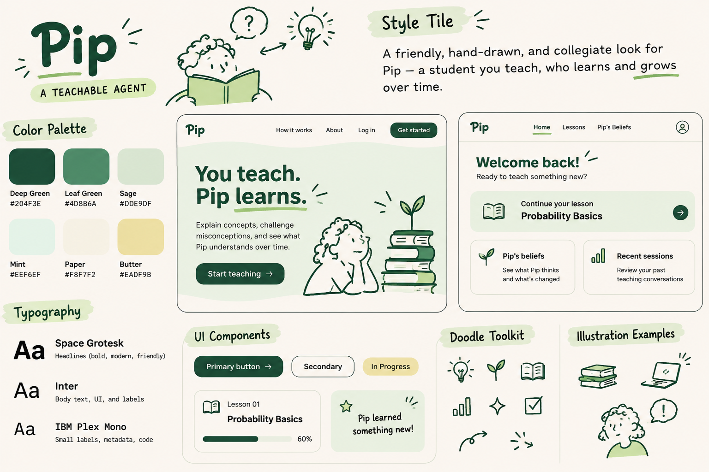

# Design

## The style tile

`pip-style-tile.png` is the visual direction for the whole app: a friendly, hand-drawn, collegiate look for Pip, a student you teach, who learns and grows over time. Everything in the interface should be traceable to it.

- **Palette, all greens plus one highlight.** Deep green `#204F3E` (headings, primary actions, the brand), leaf green `#4D8B6A` (accents, underlines, ticks), sage `#DDE9DF` (cards, selected states, marker bands), mint `#EEF6EF` (quiet panels), paper `#F8F7F2` (the page), butter `#EADF9B` (the only highlight: in-progress states, sticky notes), charcoal `#222222` (text and every illustration outline).
- **Type.** Space Grotesk for headlines (bold, modern, friendly), Inter for body text, UI and labels, IBM Plex Mono for small labels, metadata and code.
- **Components.** A deep-green primary button, an outlined secondary, a butter "in progress" chip; lesson cards with a progress bar; sticky-note callouts ("Pip learned something new!"); 12 to 16px corners; no gradients.
- **Doodle toolkit.** Lightbulb, sprout, open book, bars, star, checkbox, arrows and ticks, drawn as loose strokes with fills limited to the palette. The books, laptop and speech bubbles in the illustration examples use the same strokes.
- **Pip.** A curly-haired student in a sage shirt. In the app Pip appears at avatar size (chat rows, the About page); the landing hero is composed from the toolkit instead of a large character drawing, by decision of the Nov 2026 review.

The tokens that implement this live in `src/app/globals.css`; the README's "Design system" section lists them.

## Redesign PRs

Each redesign PR adds its screenshots here so the review has them next to the tile.

- **PR 1, design system and public landing page:** [`pr1-landing-desktop.png`](pr1-landing-desktop.png) (1360px) and [`pr1-landing-phone.png`](pr1-landing-phone.png) (390px).
